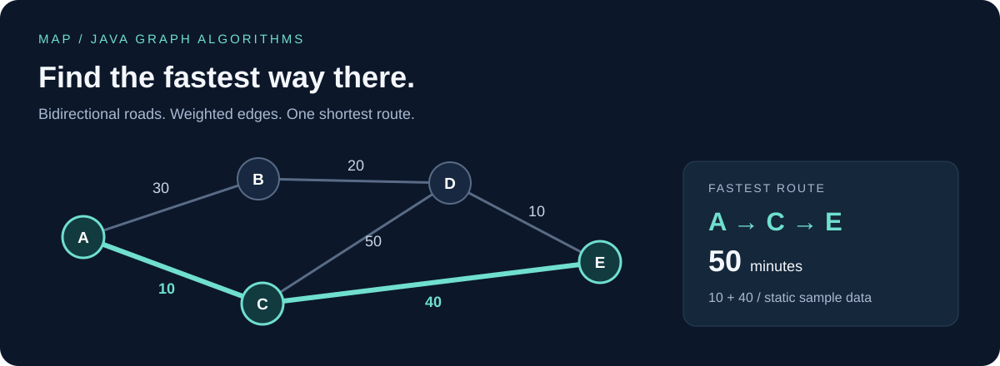

# MAP | Fastest Route Finder

**A Java command-line application that finds the fastest route between cities using Dijkstra's algorithm.**

Built by **Hayrünisa Toprak** as an SE115 programming course project, then refined into a reproducible portfolio project. It turns a text-based road network into a route and total travel time, with explicit validation and automated correctness checks.



## Try it in a minute

Requires a **JDK 17 or newer**; no external libraries, package manager, or API keys.

Run from the repository root (the commands work in PowerShell, cmd, bash, and zsh):

```sh
git clone https://github.com/hnisa2/MAP.git
cd MAP
javac --release 17 -d build/classes src/City.java src/RouteResult.java src/WayFinder.java src/MapParser.java src/CountryMap.java
java -cp build/classes CountryMap examples/sample-map.txt
```

```text
A->C->E Total Time: 50 minutes
Saved to <absolute path>/output.txt
```

The route is printed to the console and written to `output.txt`. Supply a second argument for a custom output file:

```sh
java -cp build/classes CountryMap examples/sample-map.txt build/route.txt
```

> This is a graph-algorithm project using static, user-supplied travel times. It does not use GPS, a live map service, or real-time traffic data.

## What it demonstrates

- **Graph modeling:** named cities and bidirectional, positively weighted roads.
- **Algorithm implementation:** matrix-based Dijkstra, predecessor tracking, and path reconstruction.
- **Separation of concerns:** parsing, route calculation, result formatting, and file I/O.
- **Defensive input handling:** line-numbered errors, undeclared and duplicate city detection, missing-line checks, and positive travel-time validation.
- **Correctness checks:** regression cases and 100 reproducible random graphs compared with an independent Floyd-Warshall implementation.
- **Reproducible builds:** standard JDK commands and CI configured for Java 17/21 on Linux and Windows.

## Input format

```text
5
A B C D E
6
A B 30
A C 10
B D 20
C D 50
C E 40
D E 10
A E
```

| Line | Meaning |
| --- | --- |
| 1 | Positive number of cities |
| 2 | Unique, case-sensitive city names, separated by whitespace |
| 3 | Non-negative number of road records |
| Next records | `City1 City2 Minutes`, one road per line |
| Final record | Start city and destination |

Each road can be traveled in either direction. Travel time is an integer from 1 to 2,147,483,647 minutes; route totals use `long`. For repeated roads, the smallest time is retained. Names cannot contain whitespace. Blank required lines are rejected; trailing blank lines are allowed.

In this example, **A → C → E = 10 + 40 = 50 minutes**. The alternative A → B → D → E takes 60 minutes.

## Failure behavior

| Situation | Behavior | Exit code |
| --- | --- | --- |
| Route found | Prints and saves route and total time | `0` |
| No connecting route | Prints and saves `No route found.` | `2` |
| Invalid input, arguments, or file access | Prints an error to stderr | `1` |

Try `examples/disconnected-map.txt` and `examples/invalid-map.txt` to see both cases. An invalid input does not replace an existing output file, so always check the exit code before using a result. Input and output cannot refer to the same file.

## Run the tests

```sh
javac --release 17 -Xlint:all -Werror -d build/classes src/City.java src/RouteResult.java src/WayFinder.java src/MapParser.java src/CountryMap.java tests/MapTests.java
java -cp build/classes MapTests
```

The suite checks the report example, reverse travel, isolated cities, disconnected networks, same-city queries, parallel roads, whitespace, malformed inputs, large route totals, and CLI file behavior. Randomized checks validate both shortest travel times and the actual reconstructed paths.

## Design

```text
UTF-8 input → MapParser → WayFinder → RouteResult → CountryMap → console + output file
                           ↑
                          City
```

| Component | Responsibility |
| --- | --- |
| `City` | Immutable city name and matrix index |
| `MapParser` | Parse and validate a map with line-specific diagnostics |
| `WayFinder` | Calculate shortest routes without file I/O |
| `RouteResult` | Immutable path, reachability, total time, and text formatting |
| `CountryMap` | CLI arguments, UTF-8 file I/O, and exit codes |

The adjacency matrix and linear minimum selection give **O(V²) time and O(V²) storage**, where V is the number of cities. This keeps the original course project's approach understandable, but makes the application suitable for small educational maps. A large sparse road network would benefit from adjacency lists and a priority queue.

## Project background

The original project report describes the `City`, `CountryMap`, and `WayFinder` classes, a bidirectional travel-time matrix, Dijkstra's algorithm, and the 50-minute sample route. The current implementation preserves that foundation.

The portfolio revision adds a separate parser and result object, fixes disconnected-network and integer-overflow failures, makes path reconstruction iterative, and adds tests, examples, documentation, and CI. These improvements are subsequent work, rather than claims about the original course submission.

Read the [technical project overview](docs/project-overview.md) for the algorithm, tradeoffs, and development history.

**Author:** [Hayrünisa Toprak](https://github.com/hnisa2)
